# XiaoAiTypeUnblock (超级小爱输入法净化)

## 📖 项目简介

**XiaoAiTypeUnblock** 是一款专为小米澎湃 OS（Xiaomi HyperOS 4 / Android 17）中内置的 **超级小爱输入法（`com.xiaomi.type`）** 打造的高级 Xposed 净化模块。

超级小爱输入法深度集成了讯飞输入法定制内核（iFlyTek SmartEngine）以及小米端云大语言模型。然而在日常使用、AI 写作、文案润色和语音转写过程中，系统设置了较为严苛的风控与敏感词过滤规则，常导致生成内容被直接截断（提示“已屏蔽敏感内容”）、语音输入中断或云端候选词库被屏蔽。

本模块采用现代 **libxposed (API 102)** 规范与 ART Runtime Hook 技术，在内存中动态净化大模型响应与引擎风控链路，还给用户完整、纯粹、无干扰的输入与 AI 创作体验。

---

## ✨ 核心功能特性

### 1. 🚀 澎湃 OS4+ 版本限制解除 (HyperOS 4+ Version Unblock)
* **业务痛点**：超级小爱输入法在每次调出与初始化时，会严格检测系统属性 `ro.mi.os.version.code`（通过 `z7.s0.f18512a` 判定系统是否低于 OS 4.0）。若在 Xiaomi HyperOS 1/2/3、MIUI 系统或第三方 AOSP ROM 上运行，输入法会强制弹出 `OS_VERSION_UNSUPPORTED` 阻断对话框并调用 `requestHideSelf(0)` 自动退出隐藏，导致键盘完全无法呼出与使用。
* **净化方案**：
  * 动态挂钩 `android.os.SystemProperties`，拦截 `ro.mi.os.version.code`、`ro.mi.os.version.name` 与 `ro.miui.ui.version.code`，向目标进程提供虚拟的 HyperOS 4.0+ 运行环境；
  * 在模块注入阶段反射修改 `z7.s0` 内存标志位，强制将 `f18512a` 阻断状态重置为 `false`；
  * 挂钩 `AIVersion.isOS4Service`、`isServiceSupport` 与 `SERVICE_SDK_INT`，解除大模型端侧 AI 服务的系统版本校验；
  * 拦截 `DialogHostActivity` 的 `OS_VERSION_UNSUPPORTED` 提示拉起，彻底杜绝异常弹窗。

### 2. 🤖 AI 表达安全拦截解除 (AI Safety Unblock)
* **业务痛点**：端云大模型在生成 AI 润色、文案扩展、智能回复时，服务端下发或本地解析时若包含 `"safety_blocked": true`，前端会触发敏感词屏蔽并抛弃生成文本。
* **净化方案**：动态挂钩 AI 响应解析器（包括完整 JSON 解析、正则降级解析、流式 token 解析），将所有安全阻断标记在内存中实时重写为 `false`，保留所有生成的文字。

### 3. 🎙️ 语音转写风控审查解除 (Voice Moderation Bypass)
* **业务痛点**：在进行语音输入（ASR）时，敏感语意会触发讯飞/小米安全策略，弹出 `CONTENT_MODERATION` 错误提示、返回 `30002` 风控错误码并直接挂断语音识别流，丢失已说内容。
* **净化方案**：拦截语音风控弹窗（Toast）、改写 `30002` 错误码为安全状态码，并抑制异常挂断回调，确保语音转写流畅不中断。

### 4. ☁️ 云端黑名单词库下发拦截 (Cloud Blacklist Block)
* **业务痛点**：SmartEngine 内核会定期从云端静默下发黑名单词库（`key_blackliststr` / `PinyinCloudAttachResult`），阻断部分云端联想与热词候选。
* **净化方案**：拦截云端词库更新通道与反序列化构造，强制清空黑名单列表，恢复全量云端拼音候选词能力。

### 5. 📋 剪贴板敏感标记忽略绕过 (Clipboard Sensitive Flag Bypass)
* **业务痛点**：Android 13+ 引入剪贴板敏感标记（`android.content.extra.IS_SENSITIVE`），部分应用复制的内容会被输入法打上敏感标签，导致快捷粘贴栏隐藏、分词联想失效。
* **净化方案**：拦截 `PersistableBundle` 与 `BaseBundle` 对敏感标记的查询，强制返回 `false`，确保剪贴板历史与快捷粘贴功能稳定可用。

### 6. ♾️ 剪贴板永久保存 (Permanent Clipboard)
* **业务痛点**：`com.miui.phrase` 默认仅保留 20 条剪贴板记录，超过 72 小时会自动清理，并会截断超长文本。
* **净化方案**：同时 Hook `com.miui.phrase` 的持久化写入与 `com.xiaomi.type` 的读取、展示和文本处理路径，取消数量、有效期与单条文字长度限制；手动删除、清空应用数据和卸载系统组件仍会移除记录。

### 7. 🎨 键盘外观与个性化定制 (Keyboard Appearance & Style Customization)
* **业务痛点**：超级小爱输入法默认采用固定底色与直角/固定圆角的键盘布局，缺乏透明度及个性化背景图等美化调节能力。
* **美化方案**：
  * **深浅色独立配置**：圆角、背景、模糊、文字色、键帽和卡片颜色及不透明度分别保存为浅色与深色两套方案。开启“跟随系统切换深浅色配置”后随系统模式自动切换；关闭后固定使用所选方案。编辑另一套方案不会改变跟随系统时的实际选择。升级后旧配置保留到浅色方案，深色方案默认采用原生配色及自动字色，跟随系统开关默认关闭；
  * **边角圆角弧度 (Corner Radius)**：支持 **0 ~ 40 dp** 动态顶部圆角调节，配合硬件级 `ViewOutlineProvider` 与 HyperOS AGSL 着色器实现按键与候选栏防锯齿贴合裁切；
  * **背景不透明度 (Opacity)**：支持 **0% ~ 100%** 调节。动态玻璃模式保留原生键盘配色，只改变原生背景的 alpha；100% 保留原背景，降低数值可透出底层毛玻璃，不再默认叠加蓝灰色染色；
  * **面板背景统一**：动态玻璃模式下，菜单和键盘选择界面共用键盘公共背景，避免内容区重复叠加底色而与标题栏、底栏产生色块分界；
  * **自定义背景 (Background)**：支持预设纯色（Catppuccin、AMOLED 纯黑、晨曦蓝、暗夜紫、极简白）及 R/G/B 三原色滑块调色；
  * **剪贴板面板同步**：剪贴板/常用语弹窗同步当前背景类型、透明度、模糊半径、圆角、文字色与菜单卡片颜色，滚动加载的条目也保持一致；
  * **按键字体颜色 (Key Text Color)**：未启用自定义颜色时保留原生字色和键帽配色；自定义纯色背景或键帽时自动适配文字对比度，也可通过 R/G/B 滑块指定按键文字、模式文字及工具栏图标颜色；
  * **键帽颜色 (Keycap Color)**：可通过 R/G/B 滑块独立设置常规与功能键帽底色，按压态自动生成反馈色，未指定字体色时会自动匹配高对比度文字；
  * **可读性底色 (Readability Scrim)**：在键盘背景下方垫一层底色，按键、候选字、工具栏图标和底部导航条统一受益，透明键盘叠在浅色或深色应用上也能看清。开关默认开启、深浅色方案共用；底色不透明度（**0% ~ 100%**，默认 35%）与颜色按方案分别保存，颜色默认随字色自动取反（浅色字配深底、深色字配浅底），也可自定义。背景本身不透明时完全被遮住，不改变外观；整体不透明度低于 40% 时设置页给出可读性提示；重启输入法后生效；
  * **键帽与卡片独立不透明度**：自定义功能键键帽、菜单功能卡片、字母键键帽颜色均提供独立的 **0% ~ 100%** 不透明度滑块（0% 全透明、100% 不透明，默认 100%），预览同步更新，各项分别保存，重启输入法后生效；

### 8. 📊 独立管理界面与实时日志看板 (Live Log & Monitor)
* **九键双拼**：在模块「键盘 → 输入方案」开启「九键双拼」，选择小鹤（默认）、自然码、微软、搜狗、智能 ABC、拼音加加或紫光方案，重启输入法后选择「拼音9键」使用。方案独立保存，复用小爱原生九键解码与候选；关闭模块开关后恢复小爱自身的双拼设置。宿主 **0.2.1053** 的静态链路与重命名样本已核对，真机输入效果待验收。
* **按键下滑快捷操作**：首页提供独立开关，默认关闭，升级继承原「字母下滑快捷操作」状态；开启并重启输入法后，按住对应键向下滑，字母随距离逐渐淡出，对应功能图标逐渐显现，轻震后松手执行。拼音九键的 **7 / 8 / 9** 分别对应全选、复制、粘贴，**4 / 6** 对应段首、段尾；26 键的 **Z / C / V / B / M** 分别对应全选、复制、粘贴、段首、段尾，18 键对应 **Z / XC / V / BN / M**。向下约 36dp 达到触发距离，48dp 图标完全显现；往回滑到触发距离以内或向旁边滑开可取消，普通点按继续输入。原有长按菜单中的字母、数字、符号选项保留，数字面板不启用快捷手势。不依赖 18 键入口显示或外观个性化，宿主接口已在小爱 **0.2.1053** 核对，真实手势仍待设备验收。
* **键盘底部间距**：提供独立的“自定义键盘底部间距”开关与 **0 ~ 100 dp** 滑块，调节按键下方的原生留白；0 dp 尽量贴底，关闭开关恢复原生间距并保留滑块数值。默认关闭，不依赖外观个性化或深浅色方案，重启输入法后生效。保留系统导航区域与悬浮键盘原生布局；通过底部间距计算特征定位，不支持的结构会跳过并显示适配状态。
* **解除键盘高度上限**：解除“键盘调节”顶部拖动与布局计算中的 50dp 增高上限，沿用原生确认、保存和重置。开关默认关闭，不依赖外观个性化；开启并重启输入法后生效。关闭后按原生高度范围显示，保留已保存的超高尺寸供重新开启时恢复；关闭期间重新确认或重置会以当前尺寸保存。已在 0.2.910 ~ 0.2.1053 上定位到对应结构；结构不同的版本（如 0.2.790 及更早）会自动跳过此项 Hook。
* **开屏启动动画**：冷启动设置页时播放约 1.6 秒的无文字净化动画——键盘中被屏蔽的按键经扫描线还原，随后汇聚成盾牌图标并画出对勾。轻触任意处可跳过；屏幕旋转等重建不重播；系统关闭动画时自动省略；可在「概览 › 模块设置 › 启动动画」中关闭。Android 12+ 的系统启动页与动画首帧同色衔接。
* **可视化看板**：内置 Material Design 管理主界面，提供核心拦截、剪贴板持久化与个性化美化特性的独立开关和参数控制。
* **实时跨进程日志**：基于非阻塞跨进程通信，无需连接电脑抓取 logcat，即可在 UI 中实时查看被净化的事件流与拦截统计。
* **一键 Root 快速重启**：支持在界面中一键申请 Root 权限强制重启输入法进程，配置秒级生效。

### 9. 🧩 解除 AI 功能机型限制 (AI Ability Unlock)
* **业务痛点**：端侧大模型能力（LLM / VLM）由 AI 服务按一组 conditions 下发白名单——机型 `whiteModels`、SoC `whiteSocs`、区域 `whiteRegions`、内存 `minRam` / `minRom`、电量 `minBattery` 等。不在白名单的机型、区域或低配设备上，相关 AI 润色、翻译、问小爱等能力入口会被判定为"不可用"而灰掉或隐藏。
* **净化方案**：挂钩 `com.xiaomi.taiyi.sdk.base.data.AIDetail` 的 `isSupport()` 与 `isAvailable()`，将被 AI 服务判定为不支持/不可用的能力在键盘侧强制放行。该裁决由外部 `com.xiaomi.aiservice` 经 ContentProvider 下发、键盘进程内解析消费，故 Hook 在本进程有效；与"OS4 版本限制解除"构成"服务总闸 + 能力分闸"的完整链路。开关默认关闭，重启输入法后生效。
* **注意**：此项仅解除键盘侧的能力入口闸门；真正执行仍需 AI 服务实际支持，确实不满足运行条件（如模型未下发）的能力可能在下游失败，可开启详细日志查看被放开的 ability（`api` / `code`）与下游状态。

### 10. 🔒 遥测与埋点拦截 (Telemetry Block)
* **业务痛点**：应用内置小米 OneTrack 统计与广告监控（`ad_monitor`），会在后台采集并上报使用埋点。
* **净化方案**：挂钩公共 API `com.xiaomi.onetrack.OneTrack.isDisable()` 恒返回 `true`，利用 OneTrack 自带的全局 kill switch，一处覆盖 `track` / `adTrack` 事件分发与网络上传全链路（上报分发器与上传层均据此拦截）。开关默认关闭，重启输入法后生效。
* **注意**：仅拦截小米 OneTrack，不涉及讯飞 SmartEngine 内核自身可能的遥测。

---

## 🛠️ 使用环境与要求

| 项目 | 要求 / 推荐配置 |
| :--- | :--- |
| **操作系统** | Android 8.0 ~ Android 17 (包含 HyperOS 1/2/3/4、MIUI 及第三方 ROM) |
| **CPU 架构** | ARM64-v8a / armeabi-v7a |
| **Root 环境** | KernelSU / APatch / Magisk (需要 Root 权限以支持一键重启输入法) |
| **Xposed 框架** | 支持 **libxposed API 102** 的现代框架 (如 **LSPosed v2.1.0+** 等) |
| **目标应用** | **超级小爱输入法** (`com.xiaomi.type`) 与 **常用语/剪贴板服务** (`com.miui.phrase`) |

> [!NOTE]
> 本模块基于最新的 **libxposed API 102** 标准构建，摒弃了传统的 legacy Xposed API 与已被废弃的 `XSharedPreferences` 方案，完美兼容 Android 14/15/16/17 (HyperOS 4) 严苛的 SELinux 策略与隐藏 API 限制。

> [!TIP]
> **小版本自适配**：AI 安全、语音风控、系统版本判定、键盘高度、底部间距、剪贴板永久保存、现代键盘外观，以及独立键盘选择、虎码/五笔、18键和字母下滑快捷操作均接入 [DexKit](https://github.com/LuckyPray/DexKit) 指纹与缓存。宿主或模块变化后重新扫描，结果保存到各进程自己的 `/data/user_de/0/<包名>/cache/xatype-*symbols.json`。缓存使用完整 ZIP 条目元数据标识并校验成员；损坏或不可加载时重扫，临时异常在下次启动重试。新增键盘接口按字符串、指令和调用关系解析，找不到或不唯一时跳过对应功能，首页展示适配结果；旧功能继续保留已验证版本的回退。新增接口已在 0.2.1053 及整体重命名样本中验证，其他版本须满足结构校验，不能据此推定全部兼容。悬浮键盘识别与 AI 面板动画仍只在 0.2.1053 上启用。可用 `scripts/verify-host-fingerprints.ps1`（剪贴板加 `-Table PhraseSymbols`）检查；详见 [DEX 缓存适配记录](docs/2026-10-15_逆向-DEX缓存适配-report.md)。

---

## 🚀 安装与使用方法


1. **获取安装包**：在 Release 页面下载最新版 APK，或自行克隆源码编译安装。
2. **启用模块**：打开 LSPosed / 对应现代 Xposed 管理器，在模块列表中找到 **超级小爱输入法净化** 并启用，确认作用域同时勾选 **超级小爱输入法 (`com.xiaomi.type`)** 和 **常用语与剪贴板 (`com.miui.phrase`)**。
3. **参数配置**：打开本模块的应用界面，按需配置风控、剪贴板永久保存、圆角、透明度、动态液态玻璃与背景图。
4. **生效模块**：
   - 点击主界面底部的 **“重启超级小爱输入法”** 按钮（需要授权 Root 权限）；
   - 或前往“系统设置 -> 应用管理 -> 超级小爱输入法”，点击 **“强制停止”**。
5. **验证效果**：调出超级小爱输入法，进行打字、AI 扩写/润色或语音转写，返回本模块界面，即可在 **“实时拦截与净化日志”** 中看到具体的拦截与重写记录。

---

## 🔬 核心工作原理与技术架构

```mermaid
graph TD
    subgraph TargetApp["超级小爱输入法 (com.xiaomi.type 进程)"]
        subgraph OS["系统与版本兼容链路"]
            SYSPROP["SystemProperties.get(ro.mi.os.*)"] -->|HyperOsVersionHook 伪装| OS_PASS["version.code: 4 / z7.s0.f18512a: false"]
            AIVER["AIVersion (isOS4Service)"] -->|HyperOsVersionHook 劫持| AI_SERVICE_PASS["isServiceSupport: true"]
        end

        subgraph Style["外观美化链路"]
            STYLE_CONF["ConfigManager (圆角/透明度/边距/背景)"] -->|KeyboardStyleHook| ROOT_VIEW["l8.c / u9.s (Compose 视图)"]
            ROOT_VIEW -->|ViewOutlineProvider| CORNER_CLIP["硬件圆角裁切"]
        end

        subgraph AI["AI 表达链路"]
            LLM_RESP["大模型 JSON / 流式响应"] --> FBS["fb.s 解析器 (h / e / f)"]
            FBS -->|AiSafetyHook 篡改| AI_CLEAN["safety_blocked: false"]
        end

        subgraph Voice["语音转写链路"]
            ASR_IN["ASR 语音流"] --> MICLAW["a8.n / s8.f / s8.d"]
            MICLAW -->|VoiceModerationHook 拦截| VOICE_PASS["重写 30002 错误 / 丢弃审查中断"]
        end

        subgraph Cloud["词库引擎链路"]
            CLOUD_REQ["云端词库更新"] --> ENGINE["c1 / PinyinCloudAttachResult"]
            ENGINE -->|CloudBlacklistHook 拦截| CLOUD_CLEAN["清空 key_blackliststr"]
        end

        subgraph Clip["系统剪贴板"]
            SYS_CLIP["ClipData"] --> BUNDLE["PersistableBundle / BaseBundle"]
            BUNDLE -->|ClipboardSensitiveHook| CLIP_PASS["IS_SENSITIVE: false"]
        end

    end

    subgraph ModuleApp["模块主进程 (io.mo.xatype)"]
        CONFIG["ConfigManager (RemotePreferences / Provider)"] -.->|IPC 共享配置 & 背景图| TargetApp
        UI["MainActivity 控制台 (功能开关 / 外观个性化)"] --> CONFIG
    end
```



### 1. 关键 Hook 点逆向分析与实现

| 拦截模块 | 目标类与方法 | 拦截机制与业务逻辑 | 源码位置 |
| :--- | :--- | :--- | :--- |
| **外观美化注入** | `MiInputMethodService.onCreateInputView`<br>`MiInputMethodService.onStartInputView` | 拦截根视图，注入自定义圆角、透明度、动态液态玻璃及背景图/纯色。 | [`KeyboardStyleHook.kt`](file:///app/src/main/java/io/mo/xatype/hooks/KeyboardStyleHook.kt) |
| **OS4限制解除** | `android.os.SystemProperties.get/getInt` | 伪装 `ro.mi.os.version.code` 为 `4`，`ro.mi.os.version.name` 为 `OS4.0`。 | [`HyperOsVersionHook.kt`](file:///app/src/main/java/io/mo/xatype/hooks/HyperOsVersionHook.kt) |
| **版本标志重置** | `z7.s0` 静态字段 `f18512a` | 反射重置版本阻断字段为 `false`，消除启动自退与弹窗限制。 | [`HyperOsVersionHook.kt`](file:///app/src/main/java/io/mo/xatype/hooks/HyperOsVersionHook.kt) |
| **AI版本支持** | `AIVersion.isOS4Service`<br>`AIVersion.isServiceSupport` | 拦截 AI 服务版本检测方法并强制返回 `true`，解除端云大模型服务绑定。 | [`HyperOsVersionHook.kt`](file:///app/src/main/java/io/mo/xatype/hooks/HyperOsVersionHook.kt) |
| **版本弹窗压制** | `DialogHostActivity.onCreate` | 拦截 `OS_VERSION_UNSUPPORTED` 弹窗意图并立即销毁，杜绝用户感知。 | [`HyperOsVersionHook.kt`](file:///app/src/main/java/io/mo/xatype/hooks/HyperOsVersionHook.kt) |
| **AI 表达净化** | `fb.s.h(String)`<br>`fb.s.e(String)`<br>`fb.s.f(String)` | 匹配 JSON 与流式 Token 中的 `"safety_blocked": true`，替换为 `"safety_blocked": false`。 | [`AiSafetyHook.kt`](file:///app/src/main/java/io/mo/xatype/hooks/AiSafetyHook.kt) |
| **语音风控拦截** | `a8.n.f(Context, String, String)` | 拦截 Miclaw 错误提示，检测到 `CONTENT_MODERATION` 时返回 `null` 压制弹窗。 | [`VoiceModerationHook.kt`](file:///app/src/main/java/io/mo/xatype/hooks/VoiceModerationHook.kt) |
| **ASR 错误码重写** | `s8.f.m(int, String)` | 捕获语音风控状态码 `30002` 并重写为安全状态码 `-1`。 | [`VoiceModerationHook.kt`](file:///app/src/main/java/io/mo/xatype/hooks/VoiceModerationHook.kt) |
| **ASR 会话保护** | `s8.d.e(Bundle)` | 丢弃携带 `code: 30002` 的 Bundle 回调，阻止语音引擎强行关闭输入会话。 | [`VoiceModerationHook.kt`](file:///app/src/main/java/io/mo/xatype/hooks/VoiceModerationHook.kt) |
| **云端黑名单清空** | `c1.onPyCloudAttachUpdate(...)` | 拦截云端下发附带词库，将 `blacklistStr` 参数置空。 | [`CloudBlacklistHook.kt`](file:///app/src/main/java/io/mo/xatype/hooks/CloudBlacklistHook.kt) |
| **词库实体置空** | `PinyinCloudAttachResult.get/setBlackListStr` | 强制返回空字符串并阻止黑名单内存字段写入。 | [`CloudBlacklistHook.kt`](file:///app/src/main/java/io/mo/xatype/hooks/CloudBlacklistHook.kt) |
| **剪贴板敏感绕过** | `PersistableBundle.getBoolean(...)`<br>`BaseBundle.getBoolean(...)` | 拦截 key 为 `android.content.extra.IS_SENSITIVE` 的调用并返回 `false`。 | [`ClipboardSensitiveHook.kt`](file:///app/src/main/java/io/mo/xatype/hooks/ClipboardSensitiveHook.kt) |
| **解除 AI 功能机型限制** | `AIDetail.isSupport()`<br>`AIDetail.isAvailable()` | 将被 AI 服务按机型/区域/配置白名单判定为不支持/不可用的能力在键盘侧强制返回 `true`。 | [`AiAbilityUnlockHook.kt`](file:///app/src/main/java/io/mo/xatype/hooks/AiAbilityUnlockHook.kt) |
| **遥测与埋点拦截** | `OneTrack.isDisable()` | 恒返回 `true`，借 OneTrack 自带开关关闭统计/广告监控的事件分发与网络上传。 | [`TelemetryBlockHook.kt`](file:///app/src/main/java/io/mo/xatype/hooks/TelemetryBlockHook.kt) |

### 2. 现代 Xposed 与无阻塞设计

* **原生远程配置**：通过 libxposed 的 `module.getRemotePreferences("settings")` 直接读取模块私有存储，无需配置复杂的 World-Readable 权限，彻底规避 Android 14/15/16/17 (HyperOS 4) 下存储沙盒限制。
* **极简零开销架构**：Hook 拦截与规则处理均在目标进程纯内存完成，无打字过程跨进程 IPC 与日志线程开销，极致轻量省电。
* **防御性容错**：所有 Hook 操作均被 `try-catch` 包裹，若输入法更新导致内部方法混淆或签名微调，模块将平稳跳过对应点并输出 Diagnostic Log，绝不影响输入法的常规打字与基础功能。

---

## 📂 项目结构

```text
XiaoAiTypeUnblock/
├── app/
│   ├── src/main/
│   │   ├── java/io/mo/xatype/
│   │   │   ├── XiaoAiTypeModule.kt          # XposedModule 入口类 (API 102)
│   │   │   ├── config/
│   │   │   │   └── ConfigManager.kt         # 远程与本地偏好设置统一管理
│   │   │   ├── hooks/
│   │   │   │   ├── KeyboardStyleHook.kt     # 键盘外观与个性化美化 Hook
│   │   │   │   ├── HyperOsVersionHook.kt    # 澎湃 OS4+ 版本限制解除 Hook
│   │   │   │   ├── AiSafetyHook.kt          # AI 大模型敏感阻断解除 Hook
│   │   │   │   ├── ClipboardSensitiveHook.kt# 剪贴板敏感标记绕过 Hook
│   │   │   │   ├── CloudBlacklistHook.kt    # 云端黑名单词库拦截 Hook
│   │   │   │   └── VoiceModerationHook.kt   # 语音转写 ASR 审查拦截 Hook
│   │   │   ├── provider/
│   │   │   │   └── LogContentProvider.kt    # 跨进程配置与自定义背景共享 Provider
│   │   │   ├── ui/
│   │   │   │   └── MainActivity.kt          # 模块主控制台 Activity
│   │   │   └── util/
│   │   │       └── XposedUtils.kt           # 反射与日志工具类封装
│   │   ├── resources/META-INF/xposed/
│   │   │   ├── java_init.list               # libxposed 入口声明
│   │   │   ├── module.prop                  # libxposed 模块元信息 (API 102)
│   │   │   └── scope.list                   # 默认作用域列表 (com.xiaomi.type)
│   │   └── AndroidManifest.xml
│   └── build.gradle.kts
├── LICENSE                                  # GNU GPL v3.0 开源协议
└── README.md
```

---

## 上屏后联想

在模块「键盘 → 输入增强 → 上屏后联想」中选择并重启输入法：

- **保持**（默认）：使用输入法原有的联想。
- **关闭**：文字上屏后不再显示联想词，包括后续连续联想。旧版两个关闭选项均按「关闭」处理。

适用于原生拼音与双拼候选，复用已有的动态接口适配。正常输入候选和 Emoji 候选增强独立生效，已有选词后的剩余拼音保留。

## Emoji 候选增强

在模块「键盘 → 输入增强 → Emoji 候选增强」中开启并重启输入法。打出关键词时，根据前几项汉字候选补充相关表情，保留汉字首选。每词最多 3 个、每次最多 6 个，自动去重，点选直接上屏。

参考 [WindInput 的候选过滤流程](https://github.com/huanfeng/WindInput/blob/main/wind_input/crates/wind-coordinator/src/handle_candidate.rs)，使用 Unicode CLDR 47 / Emoji 16.0 与常用别名生成 4,955 个离线关键词，保留完整组合表情。单字只保留猪、狗、猫、鸡等明确别名，避免「是」「有」等常用字频繁出现表情。数据来源、许可及生成方式见 [SOURCE-emoji.txt](app/src/main/resources/xatype/SOURCE-emoji.txt)。沿用现有 DexKit 接口指纹与缓存适配，无法匹配时保留原生引擎。

仅增强尚未选词且完整编码匹配的整词；简拼、整句内的部分词、密码框、独立形码 / 18 键引擎不增强。原生双拼读取当前方案，复用已有七种双拼编码规则，同时接受宿主返回的展开拼音和双拼编码；九键双拼使用独立设置；九键全拼与双拼都支持数字编码。开关关闭时不接管原生引擎。

已通过单元测试、Debug 构建，以及 0.2.1053.06f65b7c（21053）APK 的接口扫描、缓存重载和构造器绑定验证。原生 26 键小鹤双拼已由用户实测确认可用；其他方案与九键仍待实测。Debug 包输出有限的 `[Emoji]` 状态日志，包含方案、候选数量和点选状态，不记录输入内容。

## 形码输入实验

模块设置提供「形码输入 · 虎码 / 五笔」。内置虎码字词，也可导入 UTF-8 五笔等静态码表，复用小爱的键盘与候选栏。2.1.6.1 起可直接在小爱「键盘选择」或设置页「键盘类型」中选择「虎码/五笔」；模块页面的开关只控制入口是否显示。2.1.6.5 起按宿主接口指纹解析，已在 0.2.1053 及整体改名样本中验证；结构不兼容时保留原生引擎，真实输入体验仍待验收。使用步骤、码表格式与限制见[形码原型说明](docs/shape-input-prototype-20261013.md)。

使用 `./gradlew :app:assembleShapePrototype` 构建带实验版本后缀的安装包；没有配置正式签名时使用开发签名。

## 18键键盘原型

模块提供「18键键盘 · 离线拼音 / 可交互预览」。按照 7＋6＋5 个字母键布局实现分组输入，使用内置65,125条字词的独立离线解码，并复用小爱的原生候选栏和上屏流程。2.1.6.1 起可在小爱「键盘选择」或设置页「键盘类型」中选择「18键」，与「拼音26键」「虎码/五笔」直接切换。两个实验入口可同时显示，模块内各有一个显示开关；修改显示设置后需重启输入法。新安装默认显示，升级时继承旧开关状态。2.1.6.5 起通过接口指纹适配，已验证 0.2.1053 及整体改名样本；其他版本须满足结构校验，真实输入体验仍待验收。

2.1.8.2 起支持 **18键双拼**：进入模块「键盘 → 输入方案 → 18 键键盘」，开启「18键双拼」并选择方案，默认小鹤，另支持自然码、微软、搜狗、智能 ABC、拼音加加和紫光。页内预览立即切换；重启输入法后，在小爱「键盘选择」中选择「18键」。按双拼编码点对应的分组键，长按可选准确字母；微软、搜狗、紫光的分号韵母共用 **L** 键，也可长按 L 选择分号。关闭双拼恢复全拼/简拼。18键与九键的开关、方案各自保存；说明与验证见 [18键双拼](docs/keyboard18-shuangpin-20261017.md)。

可使用 `./gradlew :app:assembleKeyboard18Prototype` 构建原型；本次独立选择改动已完成桌面测试与Debug构建，尚未验收为日常版本。使用方法、源码接入、词库来源及当前限制见[18键原型说明](docs/keyboard18-prototype-20261014.md)。

2.1.7 修复18键宿主服务字段类型匹配错误导致 Hook 未安装的问题，并在设置页显示安装失败原因和布局替换状态。升级后重启输入法，再选择「拼音26键」。

2.1.8 新增首字母简拼，输入「为什么」可以依次点 `WE → SD → M`（`wsm`），并改善有效词语与拼接候选的排序。新增回归用例由 GitHub 构建工作流执行，真机使用效果仍待验收。

2.1.9 调整18键外观：字母键恢复正常键面配色，双字母增加间距，主字缩小，数字/符号提示居中，第二行对称缩进；预览同步更新，颜色继续跟随现有主题及外观设置。

2.1.6.1 新增独立键盘选择及两个显示开关，选择记忆在重启后保留，选择「拼音26键」恢复原生拼音。版本回到正式 Release 2.1.6 基准并追加第四段修订号（2.1.7–2.1.9 为此前未正式发布的工作树版本）。本次60项桌面单元测试、宿主静态接口检查及 Debug APK 构建通过，真机切换和输入仍待验收；详见[接入记录](docs/2026-10-15_逆向-独立键盘选择-report.md)。

2.1.6.2 将底排字母长按快捷操作拆为首页独立开关，同时支持 18 键与拼音/英文 26 键；关闭后移除菜单中的快捷操作，18 键预览同步开关状态。69 项桌面单元测试、11 个宿主类的静态接口检查及 Debug APK 构建通过，尚待真机验收；详见[长按快捷操作接入记录](docs/2026-10-15_逆向-字母长按快捷操作-report.md)。

2.1.6.3 修复中文 26 键长按不出现快捷操作：原生中文键盘使用小写键码和大写键面，之前的大小写严格匹配会跳过整个布局。改为按同一字母识别，保留原键码与键面，补充中文/英文、Shift 开关及分离布局的回归覆盖。70 项桌面单元测试、12 个宿主类的静态接口检查及 Debug APK 构建通过，真机效果仍待确认。

2.1.6.4 改为按住字母下滑、松手执行，字母与功能矢量图标随滑动距离连续淡入淡出；支持滑回取消，18 键预览同步手势，沿用原开关状态。78 项桌面单元测试、28 个宿主类接口检查及 Debug APK 构建通过，真实输入法中的触控与绘制仍待验收；详见[下滑快捷操作接入记录](docs/2026-10-15_逆向-下滑快捷操作-report.md)。

2.1.6.5 补齐 DEX 缓存失效标识、命中校验、临时异常重试及剪贴板动态加载缓存，并将键盘选择、形码、18键、下滑快捷操作和排版接入七组接口指纹。Debug/Release 各84项单元测试与构建通过；0.2.1053、整体重命名样本、五版剪贴板完成独立探针验证。旧版未匹配的实验键盘会保留原生路径，真实输入和手势仍待验收；详见 [DEX 缓存适配记录](docs/2026-10-15_逆向-DEX缓存适配-report.md)。

2.1.6.6 将下滑快捷操作扩展到原生拼音九键：7/8/9 为全选/复制/粘贴，4/6 为段首/段尾。首页名称改为「按键下滑快捷操作」，沿用原开关；补齐首次使用九键时的初始化与布局切换校验，数字面板不启用。接入与验证见 [九键下滑快捷操作记录](docs/2026-10-16_逆向-九键下滑快捷操作-report.md)。

2.1.8.1 在正式 Release 2.1.8 的基础上新增九键双拼独立开关与七种方案，默认小鹤；通过宿主初始化期间的配置读取接入原生双拼分支，不写入小爱的全局双拼偏好。新增方案隔离、关闭、异常清理和跨线程测试；宿主与重命名样本的静态检查通过，真机验证待完成。详见 [九键双拼接入记录](docs/2026-10-17_逆向-九键双拼-report.md)。

## 🏗️ 编译构建

本项目使用 Gradle 构建。建议在具备 Android SDK 的环境下执行：

### 编译 Debug 版本
```bash
./gradlew assembleDebug
```

### 编译 Release 版本
```bash
./gradlew assembleRelease
```

编译生成的 APK 文件位于 `app/build/outputs/apk/` 目录下。

### GitHub 自动构建正式安装包

每次向任意分支推送代码（提交后同步到 GitHub），都会触发 [构建正式安装包](https://github.com/lm060719/XiaoAiTypeUnblock/actions/workflows/build-release.yml)：运行 Release 单元测试、编译并签名 Release APK、验证签名、生成 SHA-256 校验文件。

- 所有分支的正式安装包均可在对应 Actions 运行页面的 **Artifacts** 下载，保留 90 天，运行摘要中也会显示下载链接。
- 自动构建只上传安装包到 Actions，不创建 Git 标签或发布 GitHub Release。
- 也可以在 Actions 中点击 **Run workflow** 手动构建。
- 一次推送包含多个提交时，构建该次推送的最后一个提交。仅在本地提交、尚未推送时不会触发。

安装包名称包含应用版本、构建序号和提交短哈希，方便对应源码。应用的 `versionName`、`versionCode` 仍由 `app/build.gradle.kts` 管理；发布新应用版本时请同步递增版本号。

#### 首次配置签名

在仓库 **Settings → Secrets and variables → Actions → New repository secret** 配置以下四项：

| Secret | 内容 |
| --- | --- |
| `ANDROID_KEYSTORE_BASE64` | 正式签名 keystore 文件的完整 Base64 编码 |
| `ANDROID_KEYSTORE_PASSWORD` | keystore 密码 |
| `ANDROID_KEY_ALIAS` | 签名密钥别名 |
| `ANDROID_KEY_PASSWORD` | 签名密钥密码 |

必须使用已发布正式 APK 的同一份签名密钥，才能覆盖安装旧版本。工作流缺少签名配置时会明确报错，不会发布未签名 APK。密钥只保存到 GitHub Secrets 和构建机临时目录，构建结束后清理临时文件。

本地需要编译签名正式包时，设置 `ANDROID_KEYSTORE_PATH`（keystore 路径）及上述三个密码/别名环境变量后执行 `./gradlew :app:assembleRelease`。不设置签名环境变量时，本地 Release 仍按原有方式输出未签名 APK，Debug 构建不受影响。

---

## ⚖️ 开源协议与免责声明

### 开源协议
本项目基于 **[GNU General Public License v3.0 (GPL-3.0)](LICENSE)** 协议开源。在遵守此协议的前提下，任何人均可自由分发、修改与使用本项目源码。

### 免责声明
1. 本项目仅供 Android 逆向工程、Hook 原理研究与个人设备定制学习使用。
2. 目标应用“超级小爱输入法”的一切知识产权归属于小米科技有限责任公司及相关权利人。
3. 请在遵守当地法律法规的前提下使用本模块，严禁将本模块用于任何违法犯罪或侵犯他人合法权益的场景。作者不对使用本软件所产生的任何直接或间接后果承担法律责任。
